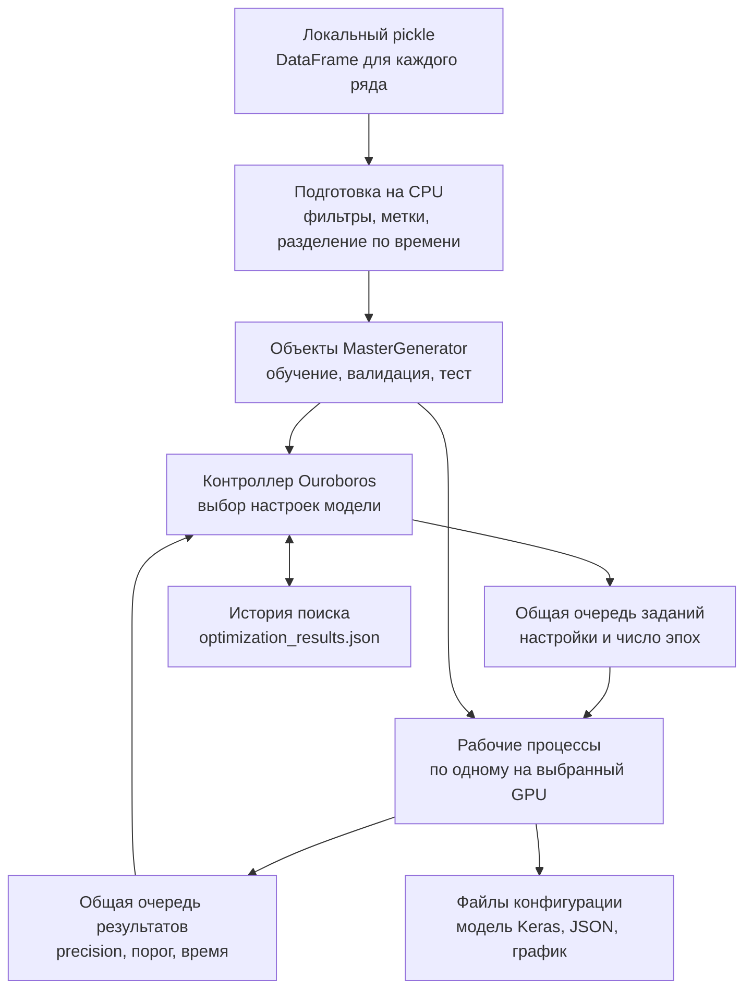
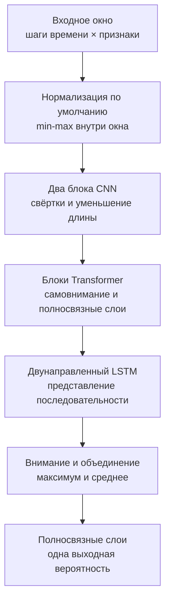

# Архитектура

[English version](ARCHITECTURE.md) · [Обзор проекта](README.RU.md) · [Рабочие примеры](examples/README.RU.md)

Планировщик GPU запускает независимые обучения и использует готовые результаты
для выбора следующих конфигураций. Встроенная интеграция TensorFlow/Keras превращает
локальные временные ряды в окна с метками и обучает классификатор. Разделы о данных
и модели ниже описывают эту интеграцию; [точки адаптации](#адаптация-под-свою-задачу)
показывают, что меняется для другой задачи.

## Данные и выполнение

Исходные данные — доверенный локальный pickle с `dict[str, pandas.DataFrame]`.
Каждый ключ обозначает отдельный ряд. Загрузчик вычисляет фильтры активности по
объёму, диапазону цены и ликвидности, затем размечает будущее движение цены с
заданным окном и пропуском. Все ряды делятся по общим временным границам: последний
период идёт в тест, предшествующий — в валидацию, более ранние строки — в обучение.
Фильтры и метки вычисляются до этого разделения.

`MasterGenerator` хранит массивы признаков, метки и индексы допустимых окон.
Окно содержит последовательные строки признаков; метка берётся из следующей
строки. Для обучения в каждой эпохе выбирается поровну примеров обоих классов.
Валидация и тест используют оба класса без балансировки. Генераторы перемешивают
индексы и возвращают полные пакеты. Подготовка на CPU использует пулы процессов,
число которых ограничено размером входных данных.

Загрузчик также принимает сохранённые генераторы; CLI поиска восстанавливает их
настройки подготовки. Для исходных данных рядом с файлом создаётся кеш генераторов. Столбцы,
примеры настроек и пути к результатам описаны в [руководстве](examples/README.RU.md).

## Модель и оценка

По умолчанию каждый признак внутри окна приводится к диапазону `[-1, 1]`;
флаг модели выбирает вместо этого слой Keras `Normalization`. Свёртки CNN выделяют
локальные закономерности и сокращают последовательность. Блоки Transformer связывают
шаги времени, а двунаправленный LSTM обрабатывает последовательность в обе стороны.
Внимание, максимум и среднее по времени, затем полносвязные слои сводят её к
вероятности положительного класса.

Функция потерь `ImbaFocalLoss` сильнее учитывает трудные примеры и дополнительно
взвешивает ложные положительные ответы. Её параметры входят в настройки модели
и сохраняются в файле Keras. Adam ограничивает норму градиента. Обратные вызовы
обучения отслеживают precision на валидации при фиксированном пороге `0.75`,
снижают скорость обучения при плато, останавливают обучение при плато и записывают
модель после каждой эпохи. Для оценки загружается последний записанный файл.

После обучения тренер выбирает порог уверенности на валидации, предпочитая варианты
с заданной минимальной долей истинных положительных ответов. Если таких вариантов
нет, берётся максимум precision на кривой precision-recall. Этот порог применяется
к тесту; счётчики, precision, recall и другие метрики записываются в JSON, рядом
создаётся график вероятностей. Оптимизатор получает **precision на тестовой выборке** как оценку
конфигурации. Метрика обратных вызовов и итоговая оценка поиска играют разные роли.
Команда `--test --model ...` оценивает сохранённую модель при заданном пороге;
отдельный запуск показан в руководстве с примерами.

## Контроллер, задания и рабочие процессы

`OuroborosOptimizer` выбирает кандидатов и заполняет свободные места для заданий.
Задание содержит настройки модели, идентификатор конфигурации, число эпох и время
постановки. `TaskManager` отслеживает ожидающие и выполненные конфигурации, чтобы
при выборе пропускать повторы. Контроллер обрабатывает результаты по мере готовности.

`WorkerManager` создаёт по процессу на каждый выбранный GPU. CLI по умолчанию
использует `spawn`; каждый процесс настраивает своё устройство TensorFlow и рост
памяти, подготавливает генераторы пакетов и берёт задания из общей очереди. GPU
определяется процессом, который взял задание. Для конфигурации создаётся модель,
проходит обучение и оценка, а метрики возвращаются через общую очередь результатов.

Поиск использует следующие правила выбора:

| Правило | Выбор конфигурации | Число эпох |
| --- | --- | --- |
| Начальный поиск | Случайные настройки, пока не накопится достаточно результатов | `min_epochs` |
| Градиентные пробы | Изменение одного числового параметра около ведущего результата | `min_epochs` |
| Точки двоичного поиска | Точки диапазона параметра с сохранённой чувствительностью | `max_epochs` |
| Скрещивание и мутация | Комбинация перспективных родителей и случайные изменения | `max_epochs` |

После начального поиска `exploration_ratio` задаёт вероятность мутации; иначе
число результатов определяет выбор градиентных проб или точек двоичного поиска.
`genetic_only` включает мутации после начального этапа. Если правило не даёт
кандидата, контроллер выбирает новые случайные настройки. Чувствительность оценивается
по изменению precision при разных значениях параметра. Перспективные родители
группируются по округлённой precision. При сортировке истории конфигурации текущего
запуска получают прибавку `0.01`; лучший результат учитывается по исходной precision.

## Настройки и повторный запуск

Аргументы CLI имеют приоритет над JSON. Пути считаются от рабочего каталога;
ключи JSON совпадают с именами аргументов, например `save_dir` и `min_epochs`.

| Настройки | Основные параметры |
| --- | --- |
| CLI обучения и данных | Датасет, каталог результатов, окно, шаг, метки, фильтры, периоды выборок, размер пакета, seed |
| JSON модели для отдельного обучения | Размеры внимания, блоки, полносвязные слои, dropout, нормализация и веса потерь |
| CLI поиска | Индексы GPU, контекст процессов, начальные точки, число эпох и конфигураций, генетический режим |
| Python `OuroborosConfig` | Доля исследования, вероятность мутации, точки проб, глубина двоичного поиска и порог улучшения |

Диапазоны поиска находятся в `hyperparameters.py`: размеры внимания, блоки
Transformer, полносвязные слои, dropout и параметры focal loss. Индексы GPU относятся
к видимым устройствам TensorFlow. Для каждого датасета или эксперимента нужен свой
каталог результатов: он определяет, какая история будет использована повторно.

После каждого принятого результата контроллер записывает `optimization_results.json`
через временный файл и замену. Записи содержат настройки, оценки, пороги, заданные
эпохи и время; файл также хранит лучшие настройки, чувствительность и оценки
длительности. При запуске восстанавливаются допустимые записи, их идентификаторы
исключаются из новых кандидатов. `max_configurations` задаёт дополнительный бюджет
конфигураций нового запуска. Модель используется повторно явно: `--model` загружает
файл и начинает ещё один вызов обучения с заданным числом эпох.

## Адаптация под свою задачу

Подход к планированию можно использовать с другими моделями и типами данных.
В текущей реализации контроллер связан с конкретными Python-типами и рабочим
процессом TensorFlow/Keras; перенос на другую задачу требует правок кода.

| Что адаптируется | Модули и их ответственность |
| --- | --- |
| Параметры и пространство поиска | [create_model.py](src/gpu_hyperparam_scheduler/create_model.py), [hyperparameters.py](src/gpu_hyperparam_scheduler/hyperparameters.py) и [parameter_sampler.py](src/gpu_hyperparam_scheduler/parameter_sampler.py): поля параметров, допустимые диапазоны, выбор конфигураций и правила скрещивания/мутаций для модели |
| Входные данные и пакеты | [data_loader.py](src/gpu_hyperparam_scheduler/data_loader.py), [data_generator.py](src/gpu_hyperparam_scheduler/data_generator.py) и [настройки процесса](src/gpu_hyperparam_scheduler/types.py): подготовка, генераторы и передача данных каждому процессу |
| Выполнение эксперимента | [gpu_worker.py](src/gpu_hyperparam_scheduler/gpu_worker.py) и [model_trainer.py](src/gpu_hyperparam_scheduler/model_trainer.py): создание модели, обучение, оценка и выходные файлы |
| Целевая метрика и обработка результатов | [types.py](src/gpu_hyperparam_scheduler/types.py), [task_manager.py](src/gpu_hyperparam_scheduler/optimizers/ouroboros/task_manager.py) и [knowledge_nexus.py](src/gpu_hyperparam_scheduler/optimizers/ouroboros/knowledge_nexus.py): поля результата, ранжирование, оценка чувствительности и оценки при ошибках; интеграция из примера максимизирует `precision` |

Очереди заданий и результатов и жизненный цикл контроллера согласуются с этими
типами. При смене данных, состава параметров или метрики нужен новый каталог
результатов: идентификатор конфигурации содержит параметры модели, но не данные.
История восстанавливает завершённые эксперименты; сохранённая модель прерванного
обучения автоматически не подхватывается. [Руководство по примеру](examples/README.RU.md)
описывает формат входных данных и протокол оценки встроенной интеграции.

## Ошибки и проверки

Обработанные `ValueError` и `RuntimeError` при оценке модели превращаются в результаты
с нулевой оценкой. Фатальная ошибка подготовки процесса отправляет маркер сбоя,
который останавливает контроллер. Мониторинг пишет в журнал о завершившихся или
неотвечающих процессах; мониторинг заданий предупреждает о необычной длительности.
Завершение работы останавливает мониторинг, отправляет маркеры в очередь и ждёт
процессы, затем принудительно завершает те, которые продолжают работать.

Проверки на CPU проходят настоящую подготовку данных, обучение, загрузку модели
и создание отчётов. Тесты планировщика сохраняют контроллер и очереди, заменяя оценку
модели лёгким обработчиком; они проверяют повторное использование истории,
дополнительный бюджет и отслеживание повторов. См. [тесты](tests/) и [CPU CI](.github/workflows/ci.yml).
Происхождение модулей и перенос описаны в [PROVENANCE.md](PROVENANCE.md) на английском.
