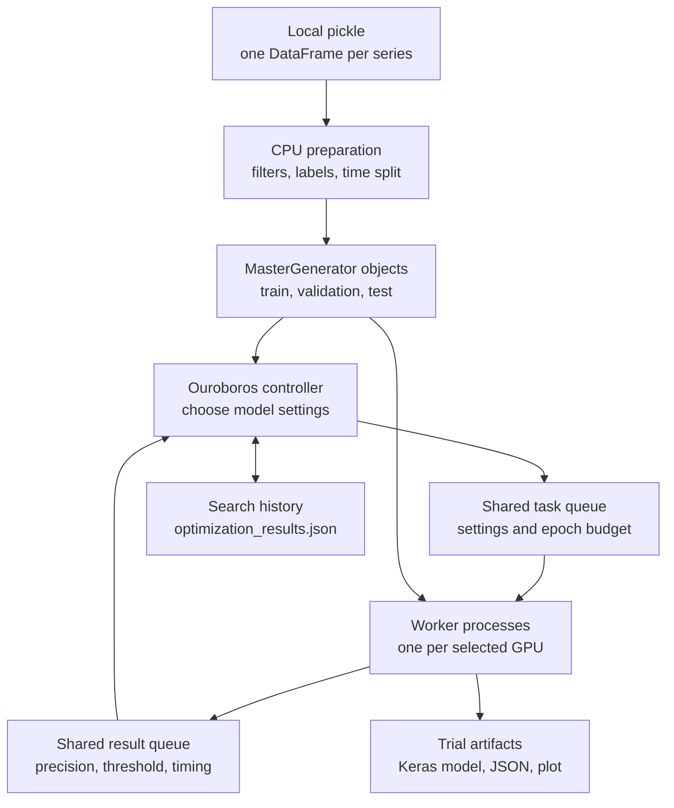
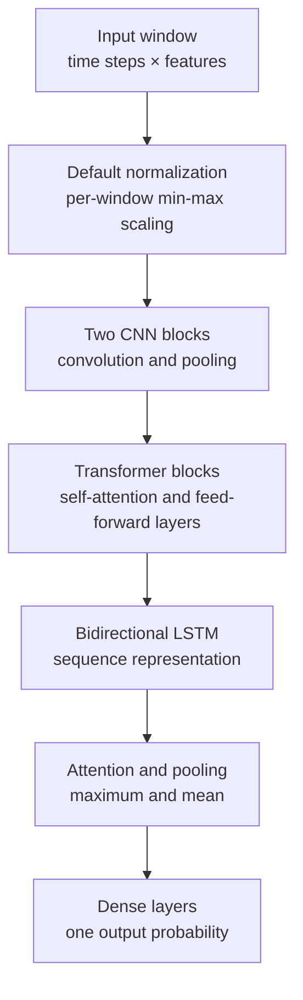

# Architecture

[Русская версия](ARCHITECTURE.RU.md) · [Project overview](README.md) · [Working examples](examples/README.md)

The GPU scheduler runs independent training trials and uses completed results to
choose later candidates. The included TensorFlow/Keras integration turns local
time series into labeled windows and trains a classifier. The data and model
sections below describe that integration; [adaptation points](#adapt-the-integration)
cover reuse for a different task.

## Data and execution

Raw input is a trusted local pickle containing `dict[str, pandas.DataFrame]`.
Each key identifies a series. The loader computes activity filters from volume,
price range and liquidity, then labels future price movement using the configured
forward window and skip. It splits each series at common timestamps: the latest
period is test data, the preceding period is validation, and earlier rows train.
Filters and labels are computed before that split.

`MasterGenerator` keeps feature arrays, labels and valid window indices. A window
contains consecutive feature rows; its label comes from the following row.
Training samples equal numbers from both classes each epoch. Validation and test
use both classes without balancing. Batch generators shuffle their indices and
return complete batches. CPU preprocessing uses process pools sized to the input.

The loader also accepts saved generators; the search CLI restores their preparation
settings. Raw input produces a generator cache beside the dataset. The exact columns,
configuration examples and artifact paths are in [the example guide](examples/README.md).

## Model and evaluation

The default scaling maps each feature in a window to `[-1, 1]`; a model flag
selects a Keras `Normalization` layer instead. CNN layers extract local patterns
and shorten the sequence. Transformer blocks mix information across time, and
the bidirectional LSTM processes that sequence in both directions. Attention,
maximum/mean pooling and dense layers reduce it to a binary-class probability.

`ImbaFocalLoss` gives harder examples more weight and applies an additional weight
to false positives. Its parameters are included in model configuration and saved
with the Keras checkpoint. Adam uses gradient clipping. Training callbacks monitor
validation precision at a fixed `0.75` threshold, lower the learning rate on a
plateau, stop after a plateau, and write the model after each epoch. Evaluation
reloads the last written checkpoint.

After training, the trainer selects a confidence threshold on validation data,
preferring candidates that meet the configured minimum true-positive ratio. If none
qualify, it uses the highest precision on the precision-recall curve. It applies that threshold
to the test split and writes counts, precision, recall and other metrics to JSON,
with a probability plot. The optimizer receives this **test-split precision** as
its search score. Training's callback metric and the final search score therefore
have different roles. `--test --model ...` evaluates a checkpoint at the configured
threshold; the example guide shows this separate command.

## Controller, tasks and workers

`OuroborosOptimizer` chooses candidates and fills available worker slots. Each
task contains model settings, a configuration ID, an epoch budget and submission
time. `TaskManager` tracks pending IDs and completed configurations so candidate
generation can skip duplicates. The controller handles results as they arrive.

`WorkerManager` starts one process per selected GPU. The CLI defaults to `spawn`;
each worker configures its own TensorFlow device and memory growth, prepares its
batch generators and repeatedly takes tasks from the shared queue. The worker
that takes a task determines its GPU. Each trial creates a model, trains it,
evaluates it and returns metrics through the shared result queue.

The search uses the following candidate rules:

| Rule | Candidate generation | Epoch budget |
| --- | --- | --- |
| Initial exploration | Random settings until enough results exist | `min_epochs` |
| Gradient probes | Change one numeric setting near a leading result | `min_epochs` |
| Binary-search points | Try points across a parameter range with recorded sensitivity | `max_epochs` |
| Crossover and mutation | Combine promising parents and randomly change settings | `max_epochs` |

After initial exploration, `exploration_ratio` chooses mutation; otherwise the
result count selects between gradient and binary-search tasks. `genetic_only`
selects mutation after the initial stage. If a rule produces no candidate, the
controller samples new random settings. Sensitivity estimates come from changes
in precision across parameter values. Promising parents are grouped by rounded
precision. History ordering gives configurations evaluated in the current session
a `0.01` score preference; best-result tracking retains raw precision.

## Configuration and reuse

CLI arguments override JSON defaults. Paths are relative to the working directory;
JSON keys use argument names such as `save_dir` and `min_epochs`.

| Configuration | Main controls |
| --- | --- |
| Training and data CLI | Dataset, output directory, window, stride, labels, filters, split durations, batch size, seed |
| Model JSON for single training | Attention dimensions, blocks, dense sizes, dropout, normalization and loss weights |
| Search CLI | GPU indices, process context, initial points, epoch/configuration budgets, genetic-only mode |
| Python `OuroborosConfig` | Exploration ratio, mutation rate, probe points, binary depth and improvement threshold |

Search ranges live in `hyperparameters.py`. They cover attention sizes, transformer
blocks, dense layers, dropout and focal-loss parameters. GPU indices refer to
TensorFlow's visible device list. Use a separate output directory for each dataset
or experiment, because the directory identifies the history to reuse.

After each accepted result, the controller writes `optimization_results.json`
through a temporary file and replacement. Records contain settings, scores,
thresholds, requested epochs and timing; the file also keeps the best settings,
sensitivities and duration estimates. Startup restores valid records and excludes
their IDs from new candidates. `max_configurations` sets the additional candidate
budget for the new invocation. Model checkpoint reuse is explicit: `--model`
loads a saved model and starts another training call with the requested epochs.

## Adapt the integration

The scheduling approach can be reused for other models and data types. The
current implementation wires the controller to concrete Python types and a
TensorFlow/Keras worker; adapting another task involves code changes.

| Part to adapt | Source and responsibility |
| --- | --- |
| Parameter schema and search space | [create_model.py](src/gpu_hyperparam_scheduler/create_model.py), [hyperparameters.py](src/gpu_hyperparam_scheduler/hyperparameters.py) and [parameter_sampler.py](src/gpu_hyperparam_scheduler/parameter_sampler.py): parameter fields, valid ranges, sampling and model-specific crossover/mutation rules |
| Input and batches | [data_loader.py](src/gpu_hyperparam_scheduler/data_loader.py), [data_generator.py](src/gpu_hyperparam_scheduler/data_generator.py) and [worker configuration](src/gpu_hyperparam_scheduler/types.py): preparation, generators and the data supplied to each worker |
| Trial execution | [gpu_worker.py](src/gpu_hyperparam_scheduler/gpu_worker.py) and [model_trainer.py](src/gpu_hyperparam_scheduler/model_trainer.py): model construction, training, evaluation and artifacts |
| Objective and result handling | [types.py](src/gpu_hyperparam_scheduler/types.py), [task_manager.py](src/gpu_hyperparam_scheduler/optimizers/ouroboros/task_manager.py) and [knowledge_nexus.py](src/gpu_hyperparam_scheduler/optimizers/ouroboros/knowledge_nexus.py): result fields, ranking, sensitivity estimates and error scores; the included integration maximizes `precision` |

Keep the task/result queues and controller lifecycle aligned with these types.
Use a fresh result directory when changing the dataset, parameter schema or
objective: configuration IDs contain model parameters, not dataset identity.
History reuse restores completed trials; it does not automatically restore an
interrupted worker's training checkpoint. The [example guide](examples/README.md)
describes the bundled integration's input schema and evaluation protocol.

## Failures and verification

Handled model-evaluation `ValueError` and `RuntimeError` exceptions become zero-score
results. A fatal worker setup error sends a failure marker that stops the controller.
Worker monitoring logs exited or unresponsive processes; task monitoring warns
when a trial takes unusually long. Cleanup stops monitoring, sends queue stop
markers and waits for workers, then terminates or kills processes still running.

CPU verification exercises real data preparation, training, checkpoint reload and
report generation. Scheduler tests keep the real controller and queues, replacing
model evaluation with a lightweight evaluator; they check history reuse, additional
budgets and duplicate tracking. See [tests](tests/) and [CPU CI](.github/workflows/ci.yml).
Module origins and extraction history are recorded in [PROVENANCE.md](PROVENANCE.md).
