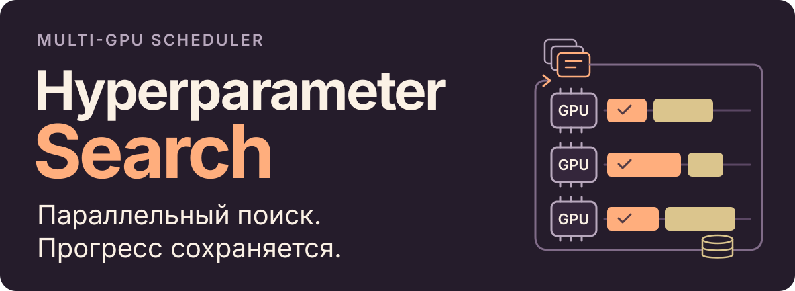

<p align="center"><a href="README.md">English</a> · <strong>Русский</strong></p>

<h1></h1>

Асинхронный планировщик для **гибридного подбора гиперпараметров на нескольких GPU**.
Он запускает независимые эксперименты параллельно, выбирает новые конфигурации
с учётом прошлых результатов и сохраняет историю для продолжения длительного поиска.

В комплекте — рабочий пример полного цикла обучения на TensorFlow/Keras.
Для своей задачи адаптируются модель, данные и код оценки результата.

[Гибридный поиск](#гибридный-подбор-гиперпараметров) · [Пример на CPU](#пример-на-cpu) · [Поиск на GPU](#поиск-на-gpu-и-продолжение) · [Свои модель и данные](#свои-модель-и-данные)

## Что берёт на себя планировщик

- **Параллельные эксперименты без ожидания всей группы.** На каждой выбранной GPU
  работает отдельный процесс с общей очередью заданий. Контроллер заполняет
  свободные слоты по мере получения результатов, не дожидаясь самого долгого запуска.
- **Прогресс между запусками.** Параметры завершённых экспериментов, оценки,
  бюджеты эпох и время выполнения сохраняются в JSON. Контроллер проверяет повторы
  среди завершённых и текущих конфигураций и восстанавливает историю при перезапуске.

## Гибридный подбор гиперпараметров

Сначала оптимизатор Ouroboros проверяет случайные конфигурации, затем сочетает
три подхода:

- **Генетический поиск:** скрещивает удачные конфигурации и применяет мутации,
  исследуя новые сочетания параметров.
- **Оценка чувствительности:** меняет один числовой параметр рядом с удачной
  конфигурацией и оценивает влияние на метрику методом конечных разностей.
- **Пробы по диапазонам:** проверяет точки в допустимом диапазоне, выбирая
  параметры по накопленным оценкам чувствительности.

Так исследование новых конфигураций сочетается с уточняющими пробами вокруг
удачных результатов. [Руководство по архитектуре](ARCHITECTURE.RU.md#контроллер-задания-и-рабочие-процессы)
описывает переключение стратегий и режим только генетического поиска.

## Пример на CPU

Python 3.12; зависимости TensorFlow 2.16 / Keras 3.3 закреплены в `uv.lock`.
Команды выполняются из корня репозитория:

```bash
uv sync --locked
uv run gpu-hyperparam-demo-data
uv run gpu-hyperparam-train --config examples/cpu.json
```

Пример локально создаёт синтетические временные ряды, обучает небольшой
классификатор одну эпоху, загружает сохранённую модель и оценивает её. На выходе:

| Локальный файл | Содержимое |
| --- | --- |
| `artifacts/cpu-demo/demo.keras` | Модель для повторной загрузки |
| `artifacts/cpu-demo/demo.json` | Метрики оценки и конфигурация |
| `artifacts/cpu-demo/demo.png` | Распределение вероятностей и анализ порога |

Для выполненного CPU-запуска опубликованы [JSON-отчёт](examples/results/cpu-demo.json)
и [график](docs/assets/cpu-demo.png). Это пример полного цикла выполнения;
[руководство](examples/README.RU.md) описывает его данные, настройки и оценку сохранённой модели.

## Поиск на GPU и продолжение

В Linux с совместимыми GPU NVIDIA и установленным драйвером используются
созданные выше данные:

```bash
uv sync --locked --extra gpu
uv run gpu-hyperparam-check
uv run gpu-hyperparam-scheduler --config examples/search.json --gpus 0,1
```

На каждой выбранной GPU работает один процесс. Результаты завершённых экспериментов
сохраняются в `optimization_results.json` в каталоге `artifacts/search/`. Повторный запуск команды
продолжает поиск. Бюджет можно задать явно — до пяти дополнительных конфигураций:

```bash
uv run gpu-hyperparam-scheduler --config examples/search.json \
  --gpus 0,1 --max-configurations 5
```

При продолжении используются те же данные и настройки; отдельным экспериментам
нужны отдельные каталоги результатов. Восстанавливаются результаты завершённых экспериментов;
прерванное обучение автоматически с последней эпохи не возобновляется.

[Руководство по примеру](examples/README.RU.md#поиск-на-gpu-и-продолжение)
описывает индексы видимых GPU, бюджеты эпох и выходные файлы.

## Свои модель и данные

Для другой задачи в Python адаптируются **описание и диапазоны параметров,
подготовка данных, выполнение эксперимента и оценка результата**. Текущий CLI
связывает эти части с примером на TensorFlow/Keras и максимизирует precision.
Смена архитектуры модели или типа данных требует адаптации этой интеграции,
помимо нового JSON-конфига.

[Руководство по интеграции](ARCHITECTURE.RU.md#адаптация-под-свою-задачу)
показывает, какие модули отвечают за эти части. Сеть из примера и порядок оценки
описаны отдельно в [архитектуре](ARCHITECTURE.RU.md#модель-и-оценка).

## Проверка и документация

[CPU CI](.github/workflows/ci.yml) проверяет импорт пакета, шаг обучения, сохранение
и загрузку модели, полный пример обучения, сохранение и продолжение поиска,
затем собирает пакет. [Тесты контроллера](tests/test_optimizer.py) используют
настоящие очереди и логику поиска с лёгкой заменой обучения: сохраняют пять
результатов, добавляют ещё две конфигурации после перезапуска и проверяют учёт повторов.

[Архитектура](ARCHITECTURE.RU.md) · [Примеры и входные данные](examples/README.RU.md) · [Тесты CLI и контроллера](tests/)

[История исходников и заметки о переносе](PROVENANCE.md).
