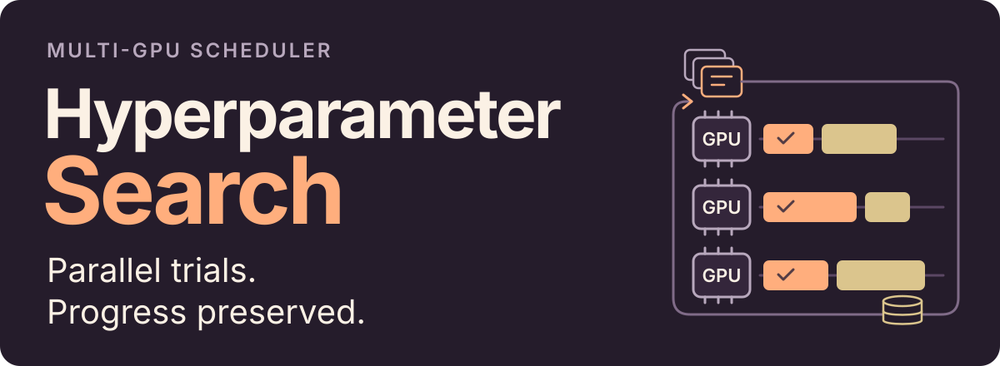

<p align="center"><strong>English</strong> · <a href="README.RU.md">Русский</a></p>

<h1></h1>

An asynchronous scheduler for **hybrid hyperparameter search across multiple GPUs**.
It runs independent trials in parallel, uses completed results to choose new
candidates and saves history so a long search can continue across launches.

The included TensorFlow/Keras example demonstrates the full training workflow.
Adapting it to another task involves the model, data and evaluation code.

[Hybrid search](#hybrid-hyperparameter-search) · [Try the CPU example](#try-the-cpu-example) · [Search on GPUs](#search-on-gpus-and-resume) · [Use your own model](#use-your-own-model-and-data)

## What the scheduler handles

- **Parallel trials without a batch barrier.** One process per selected GPU takes
  work from a shared queue. The controller fills free slots as results arrive,
  without waiting for the slowest trial in a group.
- **Progress across launches.** Completed parameters, scores, epoch budgets and
  timings are saved to JSON. The controller checks completed and pending
  configurations for duplicates and restores completed history on restart.

## Hybrid hyperparameter search

Ouroboros starts with random configurations, then combines three approaches:

- **Genetic search:** crosses promising parent configurations and mutates the
  offspring to explore new parameter combinations.
- **Sensitivity probes:** varies one numeric parameter near a leading
  configuration and estimates score sensitivity with finite differences.
- **Range probes:** tests points across the allowed range, prioritizing
  parameters using recorded sensitivity estimates.

This combines exploration of new configurations with targeted probing around
promising results. The [architecture guide](ARCHITECTURE.md#controller-tasks-and-workers)
explains strategy selection and the genetic-only mode.

## Try the CPU example

Python 3.12; TensorFlow 2.16 / Keras 3.3 dependencies are pinned in `uv.lock`.
From the repository root:

```bash
uv sync --locked
uv run gpu-hyperparam-demo-data
uv run gpu-hyperparam-train --config examples/cpu.json
```

The example creates synthetic time series locally, trains a small classifier for
one epoch, reloads its checkpoint and evaluates it. It produces:

| Local output | Contents |
| --- | --- |
| `artifacts/cpu-demo/demo.keras` | Reloadable model checkpoint |
| `artifacts/cpu-demo/demo.json` | Evaluation metrics and configuration |
| `artifacts/cpu-demo/demo.png` | Probability distribution and threshold analysis |

A completed CPU run is available as a [JSON report](examples/results/cpu-demo.json)
and [plot](docs/assets/cpu-demo.png). This is an end-to-end execution example;
the [example guide](examples/README.md) covers its data, settings and checkpoint evaluation.

## Search on GPUs and resume

On Linux with compatible NVIDIA GPUs and an installed driver, use the data
generated above:

```bash
uv sync --locked --extra gpu
uv run gpu-hyperparam-check
uv run gpu-hyperparam-scheduler --config examples/search.json --gpus 0,1
```

One worker runs on each selected GPU. Completed trials are saved in
`optimization_results.json` under `artifacts/search/`. Repeat the command to continue,
or set a budget of up to five additional configurations:

```bash
uv run gpu-hyperparam-scheduler --config examples/search.json \
  --gpus 0,1 --max-configurations 5
```

Keep the same dataset and settings when resuming; use a separate output directory
for each experiment. Resume restores completed search history; an interrupted
training trial is not automatically resumed from its last epoch.

The [example guide](examples/README.md#search-on-gpus-and-resume) explains visible
GPU indices, epoch budgets and output files.

## Use your own model and data

Reuse for another task involves adapting the **parameter definitions and ranges,
data preparation, worker evaluation and scoring** in Python. The current CLI
connects these pieces to the included TensorFlow/Keras example and maximizes
precision. Changing the model architecture or data type requires adapting that
integration, beyond supplying a different JSON configuration.

The [integration guide](ARCHITECTURE.md#adapt-the-integration) maps these changes
to the source modules. The example's network and evaluation flow are documented
separately in the [architecture guide](ARCHITECTURE.md#model-and-evaluation).

## Verification and details

[CPU CI](.github/workflows/ci.yml) checks package imports, a real training step,
checkpoint save/reload, full example training and scheduler save/resume behavior,
then builds the package. [Controller tests](tests/test_optimizer.py) retain the
real queues and search logic with a lightweight evaluator: they save five results,
resume with two additional configurations and check duplicate tracking.

[Architecture](ARCHITECTURE.md) · [Examples and input data](examples/README.md) · [CLI and controller tests](tests/)

[Source history and migration notes](PROVENANCE.md).
